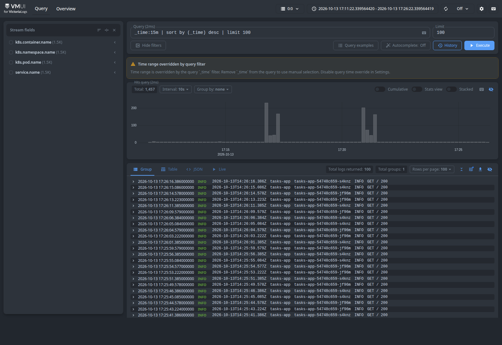
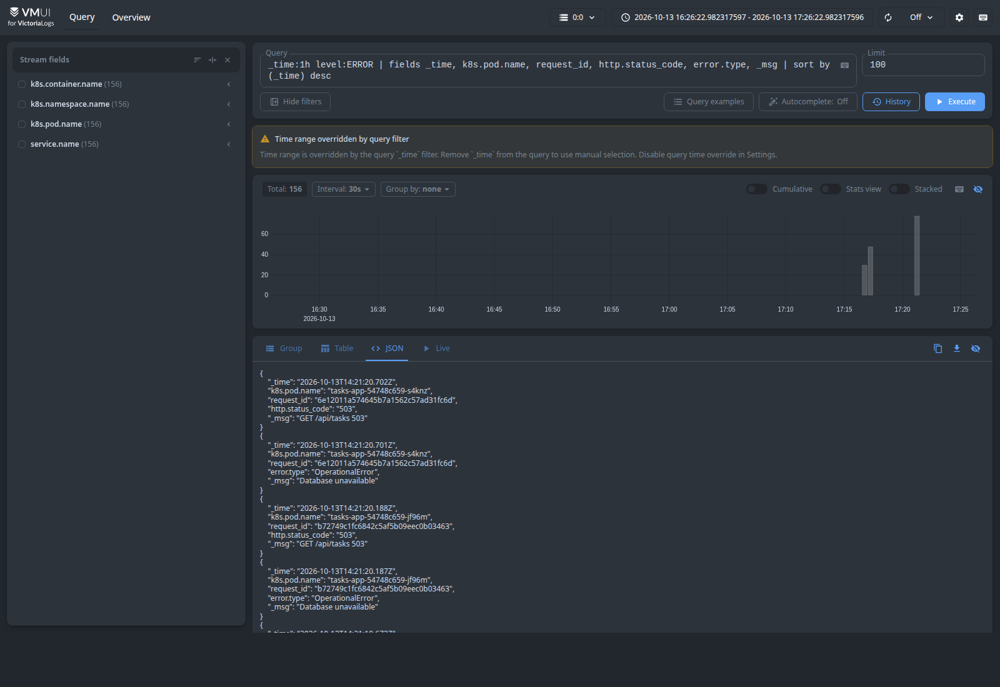
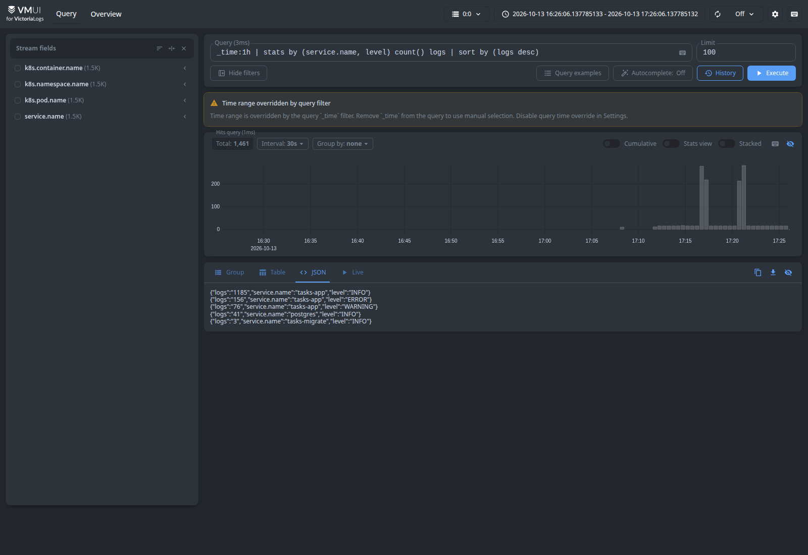
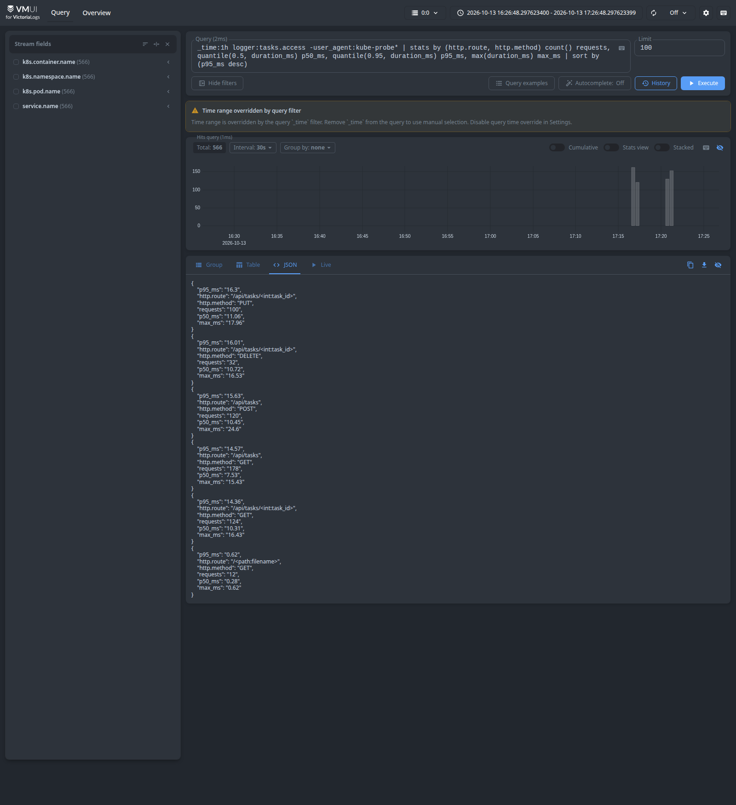

# Отчёт по ДЗ 3: Victoria Logs

## 1. Что развёрнуто

В том же minikube-кластере, где с ДЗ 2 работает приложение «Список задач» (Flask + gunicorn + PostgreSQL), добавлен namespace `logging`:

| Объект | Назначение |
| --- | --- |
| `Deployment victoria-logs` (`victoriametrics/victoria-logs:v1.52.0`) | single-node Victoria Logs, `-retentionPeriod=7d`, стратегия `Recreate` из-за RWO-тома |
| `PersistentVolumeClaim victoria-logs-data` (2Gi) | данные Victoria Logs переживают перезапуск пода |
| `Service victoria-logs` (ClusterIP, 9428) | приём логов изнутри кластера и доступ к vmui через `kubectl port-forward` |
| `DaemonSet vector` (`timberio/vector:0.50.0-distroless-libc`) | агент-шиппер на каждой ноде |
| `ServiceAccount` + `ClusterRole`/`Binding vector` | чтение метаданных подов, namespace и нод (get/list/watch) |
| `ConfigMap vector-config-<hash>` | конфиг Vector из `k8s/logging/vector.yaml`, генерируется kustomize |

```
$ kubectl get pods -A
default   postgres-0                       1/1  Running
default   tasks-app-54748c659-jf96m        1/1  Running
default   tasks-app-54748c659-s4knz        1/1  Running
default   tasks-migrate-6wrzx              0/1  Completed
logging   vector-z6f4j                     1/1  Running
logging   victoria-logs-67d446dcfb-tqb85   1/1  Running
```

Деплой выполнен простыми манифестами через `kubectl apply -k k8s/logging`, без Helm. Для одного single-node экземпляра хватает трёх объектов, и каждая настройка видна прямо в манифесте.

## 2. JSON-логи приложения

Раньше приложение писало текст: `logging.basicConfig("%(asctime)s %(levelname)s %(message)s")` и access-лог gunicorn в формате Apache. Теперь все логи пишутся в stdout по одному JSON-объекту на строку, и в Kubernetes это фактор XI методологии 12 факторов:

- `app/logs.py` содержит `JsonFormatter` на стандартном `logging`, без новых зависимостей.
- `gunicorn.conf.py` переводит логи самого gunicorn (старт, воркеры) на тот же форматтер. Его встроенный текстовый access-лог отключён.
- `app/__init__.py` пишет access-лог в хуке `after_request` и логирует доменные события `Task created/updated/deleted` и `Task validation failed`. Ошибки БД логируются вместе с трейсбеком.

Пример записи:

```json
{"timestamp": "2026-10-13T14:16:43.876Z", "level": "INFO", "message": "PUT /api/tasks/3 200",
 "service.name": "tasks-app", "service.version": "1.1", "deployment.environment": "minikube",
 "logger": "tasks.access", "request_id": "6332e66104ff4c5d9b3fe1d930589f20",
 "http.method": "PUT", "http.route": "/api/tasks/<int:task_id>", "url.path": "/api/tasks/3",
 "http.status_code": 200, "duration_ms": 7.93, "client.address": "10.244.0.1",
 "user_agent": "python-requests/2.32"}
```

Поля выбраны по чек-листу семинара:

| Поле | Зачем |
| --- | --- |
| `timestamp` | ISO 8601, UTC, миллисекунды; в Victoria Logs становится `_time` |
| `level` | `INFO` / `WARNING` / `ERROR`. Уровень access-лога зависит от статуса: 5xx даёт ERROR, 4xx даёт WARNING |
| `message` | короткое человекочитаемое сообщение; становится `_msg` |
| `service.name`, `service.version`, `deployment.environment` | кто, какая версия и где; задаются переменными окружения из ConfigMap и Deployment |
| `request_id` | корреляция записей одного запроса. Берётся из `X-Request-ID` или генерируется и возвращается в ответе |
| `http.method`, `http.route`, `url.path`, `http.status_code`, `duration_ms` | для фильтров и агрегаций. `http.route` — шаблон маршрута с низкой кардинальностью, `url.path` — фактический путь |
| `error.type`, `error.stack` | для записей с исключением |

Названия задач, то есть пользовательский ввод, и тело запроса в логи не пишутся: логи не должны содержать пользовательские данные.

Kubernetes-метаданные (`k8s.pod.name`, `k8s.namespace.name`, `k8s.container.name`, `k8s.node.name`) приложение само не пишет. Их добавляет Vector.

## 3. Доставка логов: Vector DaemonSet

Схема:

1. Контейнер пишет в stdout, на ноде это попадает в файл `/var/log/pods/<ns>_<pod>_<uid>/<container>/0.log`.
2. Vector читает файл и обрабатывает запись: источник `kubernetes_logs`, трансформация `remap`, синк `elasticsearch`.
3. Vector отправляет пачку записей запросом:

```
POST http://victoria-logs.logging.svc:9428/insert/elasticsearch/_bulk
     ?_msg_field=message&_time_field=timestamp
     &_stream_fields=service.name,k8s.namespace.name,k8s.pod.name,k8s.container.name
```

Что делает конфиг (`k8s/logging/vector.yaml`):

1. Источник `kubernetes_logs` читает файлы подов с лейблом `app.kubernetes.io/part-of=tasks`, то есть `tasks-app`, `tasks-migrate` и `postgres`, и обогащает записи метаданными из API Kubernetes.
2. Трансформация `remap` (VRL):
   - если строка — JSON-объект, берёт его как есть;
   - если строка текстовая (логи PostgreSQL), формирует `message`, `level` (по префиксу `ERROR:`/`FATAL:`/`WARNING:`) и `service.name` из лейбла `app`;
   - отбрасывает пустые строки;
   - добавляет поля `k8s.*`.
3. Синк `elasticsearch` в режиме bulk указывает в query-параметрах, какое поле считать `_msg` и `_time` и из каких полей строить `_stream`. Схему логов приложения под Victoria Logs переделывать не пришлось.

Поток (`_stream`) — это сервис плюс под и контейнер. Поля с низкой кардинальностью, по которым почти всегда фильтруют, становятся стримами, а `request_id`, `url.path`, `duration_ms` остаются обычными полями.

### Почему именно так

- **Приложение не знает о хранилище логов.** Оно только пишет в stdout. Если Victoria Logs недоступна или её заменят, код и образ приложения не меняются, и запросы пользователей не тормозят из-за отправки логов. Прямой push из приложения (Loki или ES-bulk из Python) связал бы приложение с бэкендом логов, а при недоступности бэкенда логи терялись бы или блокировали обработку запросов.
- **DaemonSet вместо сайдкара.** Один агент на ноду обслуживает все поды, включая PostgreSQL и Job миграции, которые я не собирал сам. Сайдкар пришлось бы добавлять в каждый Deployment, он умножался бы на число реплик, и логи завершённого Job было бы сложнее собрать.
- **Vector, а не Fluent Bit или OTel Collector.** На семинаре Vector и Fluent Bit названы самыми экономными по ресурсам, а OTel Collector тяжелее (у нас requests 50m CPU / 64Mi). VRL удобно разбирает JSON и текстовые логи PostgreSQL в одном месте. Sink `elasticsearch` и параметры `_msg_field`/`_time_field` — это рекомендуемая связка из документации Victoria Logs и демо-стенда семинара.
- **Файлы на ноде как буфер.** Vector хранит чекпоинты в `hostPath /var/lib/vector`. После перезапуска агента или кратковременной недоступности Victoria Logs он дочитывает файлы с места остановки.

### Проблемы, которые пришлось решить

1. **Vector видел поды, но не читал ни одного файла.** В minikube `/var/log/pods/.../0.log` — симлинк на `/var/lib/docker/containers/<id>/<id>-json.log`, а `/var/lib/docker` внутри ноды смонтирован отдельно. hostPath `/var/lib` эту точку монтирования не включал, поэтому симлинки внутри пода вели в пустоту. Решение — отдельный hostPath `/var/lib/docker/containers`.
2. **Новые поды появлялись в логах только через минуту.** У `kubernetes_logs` параметр `glob_minimum_cooldown_ms` по умолчанию равен 60000, и новые файлы ищутся раз в 60 секунд. Уменьшил до 5000.
3. **gunicorn падал с `Unable to configure root logger`.** gunicorn делает неглубокий `dict.update` своих дефолтов при `logconfig_dict`, поэтому секция `handlers` заменяется целиком, и root ссылается на удалённый хендлер `console`. Решение — явно задать `root` и заглушить `gunicorn.access`, иначе его текстовый access-лог попал бы в root.

## 4. LogsQL-запросы в vmui

Доступ: `kubectl -n logging port-forward svc/victoria-logs 9428:9428`, затем <http://localhost:9428/select/vmui/>. В Victoria Logs v1.52 vmui отдаётся по `/select/vmui/`, а путь `/vmui/` возвращает `unsupported path requested`. Перед снятием скриншотов трафик сгенерирован скриптами `scripts/generate-load.sh` и `scripts/simulate-db-outage.sh`. Второй скрипт на 20 секунд останавливает PostgreSQL, чтобы в логах появились настоящие ошибки 503. Все запросы лежат в `queries.logsql`. Скриншоты сняты скриптом `scripts/vmui-screenshots.py`: он открывает vmui в headless Chrome с запросом в URL. Предупреждение «Time range overridden by query filter» на скриншотах означает, что период задан фильтром `_time` в самом запросе, а не переключателем времени в vmui.

### (а) Сырые записи за последние 15 минут

```logsql
_time:15m | sort by (_time) desc | limit 100
```



Показывает последние записи всех собранных сервисов, свежие сверху. По ним видно, что логи доходят и разобраны: у каждой записи есть `_time` из поля `timestamp` приложения, `_msg` из `message`, `_stream` с сервисом и подом, а также все поля из JSON и поля `k8s.*` от Vector. Большую часть потока дают пробы kubelet (`GET / 200`, `user_agent: kube-probe/1.37`).

### (б) Фильтр по полю: ошибки

```logsql
_time:1h level:ERROR
  | fields _time, k8s.pod.name, request_id, http.status_code, error.type, _msg
  | sort by (_time) desc
```



Фильтр `level:ERROR` оставляет только ошибки, а `fields` сужает вывод до полей, нужных для разбора. Видны пары записей с одним `request_id`: `Database unavailable` с `error.type=OperationalError` и access-лог `GET /api/tasks 503`. Они пришли с обеих реплик во время остановки PostgreSQL. По одному запросу понятно, что сломалось, где и с каким исключением.

### (в) stats с группировкой

```logsql
_time:1h | stats by (service.name, level) count() logs | sort by (logs desc)
```



Считает число записей по каждой паре «сервис × уровень». Это быстрая сводка состояния: какие сервисы шумят и у кого есть ERROR. На скриншоте у `tasks-app` 1185 INFO, 76 WARNING (ответы 400/404) и 156 ERROR (503 во время отказа БД, по две записи на запрос). Также видны 41 запись `postgres` и 3 записи `tasks-migrate`.

Дополнительно (в') — доля ошибок по эндпоинтам, как в примере с семинара:

```logsql
_time:1h logger:tasks.access
  | stats by (http.route, http.method) count() requests, count() if (level:ERROR) errors
  | math round(errors / requests * 100, 0.1) as error_pct
  | sort by (requests desc)
```

Ошибки сосредоточены на `GET /api/tasks`: на этот эндпоинт стучался скрипт во время отказа БД.

### (г) Агрегация: quantile задержки

```logsql
_time:1h logger:tasks.access -user_agent:kube-probe*
  | stats by (http.route, http.method)
      count() requests,
      quantile(0.5, duration_ms) p50_ms,
      quantile(0.95, duration_ms) p95_ms,
      max(duration_ms) max_ms
  | sort by (p95_ms desc)
```



Для каждого эндпоинта считает медиану, p95 и максимум времени обработки запроса по полю `duration_ms` из access-лога. Пробы kubelet исключены (`-user_agent:kube-probe*`), иначе дешёвый `GET /` размывал бы картину. Эндпоинты, которые ходят в PostgreSQL, держат p95 около 14–16 мс и p50 около 7–11 мс, а отдача статики (`/<path:filename>`) — 0,6 мс. Такой запрос можно использовать как основу для SLI по латентности.

Ещё два варианта агрегации:

```logsql
# top: самые частые клиенты
_time:1h logger:tasks.access | top 5 by (user_agent)

# count_uniq: как Service распределяет запросы между репликами
_time:1h logger:tasks.access
  | stats by (k8s.pod.name) count() requests, count_uniq(request_id) unique_requests, count_uniq(user_agent) agents
```

`top` показывает, что больше всего запросов делает kubelet (пробы). `count_uniq` показывает, что запросы делятся между двумя подами примерно поровну, а у каждого запроса уникальный `request_id`.
